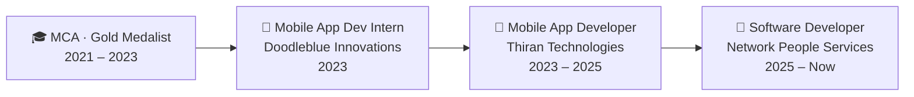

[Portfolio](https://mageshportfolio.netlify.app/) ·
[LinkedIn](https://linkedin.com/in/Mageshkanna) ·
[X](https://x.com/codermagesh) ·
[Medium](https://medium.com/@codermagesh) ·
[Stack Overflow](https://stackoverflow.com/users/18250288/magesh-kanna) ·
[Buy me a coffee ☕](https://www.buymeacoffee.com/codermagesh)

---

## 👨‍💻 About Me

Flutter developer building **secure fintech and enterprise apps** at scale: UPI payments, offline-first architecture, and AI-powered experiences. I like apps that are fast, safe, and feel great to use.

### ⚡ At a Glance

| 🗓️ **3.4+ years** | 📱 **5+ apps** | 🏦 **80M+ users** |
|:---:|:---:|:---:|
| Building Flutter apps for fintech & enterprise | Shipped to Google Play & the App Store | On the banking app I contribute to |
| ⚡ **1M records in 2 min** | 📉 **40% smaller app** | 🎤 **50+ interviews** |
| Parallel API calls instead of sequential downloads | Offline-first redesign of an enterprise app | Technical interviews conducted for freshers |

### 🧭 What I Do

| | Focus | What it looks like |
|---|---|---|
| 🏦 | **Fintech & Security** | UPI/NPCI integration, SSL pinning, device binding, secure payments, root/jailbreak detection |
| 📴 | **Offline-first Apps** | Local-first data, transaction queues that sync on reconnect, background downloads |
| 🤖 | **AI-powered Features** | Gemini via Vertex AI / Firebase AI Logic, in-app chatbots, AI itinerary pipelines |
| 🏗️ | **Architecture** | Clean Architecture, BLoC & Riverpod, dependency injection, feature flags |
| 🚢 | **Release & Delivery** | Play Store, App Store and MDM deployments, CI/CD, Agile teams |

### 🗺️ My Journey

- 🤝 Volunteer in the **Namma Flutter** Chennai community, mentoring college students in Flutter
- 🤖 Exploring AI-assisted development with **Claude Code** and **MCP servers**
- 💬 Ask me about: Flutter, UPI integration, offline sync, Firebase, state management, Play Store releases

## 🛠️ Tech Stack

### 📱 Mobile
<picture>
  <source media="(prefers-color-scheme: dark)" srcset="https://skillicons.dev/icons?i=flutter,dart,swift,kotlin,androidstudio,xcode&theme=dark">
  
</picture>
&nbsp;

### 🏗️ Architecture & State Management

### 🔐 Fintech & Security

### 🤖 Firebase, AI & AI Tooling

### 🗄️ Databases & Local Storage

### 🔌 Integrations & Monetization

### ☁️ Backend, Cloud & Web
<picture>
  <source media="(prefers-color-scheme: dark)" srcset="https://skillicons.dev/icons?i=firebase,gcp,python,django,cpp,js,html,css,netlify&theme=dark">
  
</picture>

### 📊 Data
<picture>
  <source media="(prefers-color-scheme: dark)" srcset="https://skillicons.dev/icons?i=python,numpy,pandas&theme=dark">
  
</picture>

### 🚢 Release & Delivery

### 🧰 Tools & Design
<picture>
  <source media="(prefers-color-scheme: dark)" srcset="https://skillicons.dev/icons?i=git,github,gitlab,bitbucket,gradle,vscode,postman,figma&theme=dark">
  
</picture>
&nbsp;

## 🎯 What I'm Focused On

| 🔭 Building | 🌱 Learning | 🎓 Sharing |
|---|---|---|
| Secure, high-scale fintech apps | Agentic AI workflows | Mentoring students & juniors |
| AI-powered Flutter apps | Kotlin Multiplatform | Namma Flutter community |
| Clean, testable architecture | Advanced Firebase & Vertex AI | Articles on Medium |

## ⚡ Fun Facts

- ☕ Fuelled by filter coffee and `flutter run`
- 🏅 I believe good animations are the difference between an app and an *experience*
- 🐛 My most-used debugging tool is still `print()`, and I'm not ashamed
- 🎮 I like building things that feel alive, whether that's UI or games
- 🧙‍♂️ Collecting skills one commit at a time

## 📊 GitHub Activity

<picture>
  <source media="(prefers-color-scheme: dark)" srcset="https://github-readme-stats.vercel.app/api?username=Magesh-kanna&show_icons=true&theme=tokyonight&hide_border=true&count_private=true&include_all_commits=true">
  
</picture>
<picture>
  <source media="(prefers-color-scheme: dark)" srcset="https://github-readme-stats.vercel.app/api/top-langs/?username=Magesh-kanna&layout=compact&theme=tokyonight&hide_border=true">
  
</picture>

<picture>
  <source media="(prefers-color-scheme: dark)" srcset="https://streak-stats.demolab.com/?user=Magesh-kanna&theme=tokyonight&hide_border=true">
  
</picture>

<picture>
  <source media="(prefers-color-scheme: dark)" srcset="https://github-readme-activity-graph.vercel.app/graph?username=Magesh-kanna&bg_color=0d1117&color=58a6ff&line=0175C2&point=ffffff&area=true&hide_border=true">
  
</picture>

## 📬 Let's Connect

Open to interesting Flutter and mobile engineering opportunities, collaborations, and speaking/mentoring.
Reach me via [LinkedIn](https://linkedin.com/in/Mageshkanna) or my [portfolio](https://mageshportfolio.netlify.app/).

